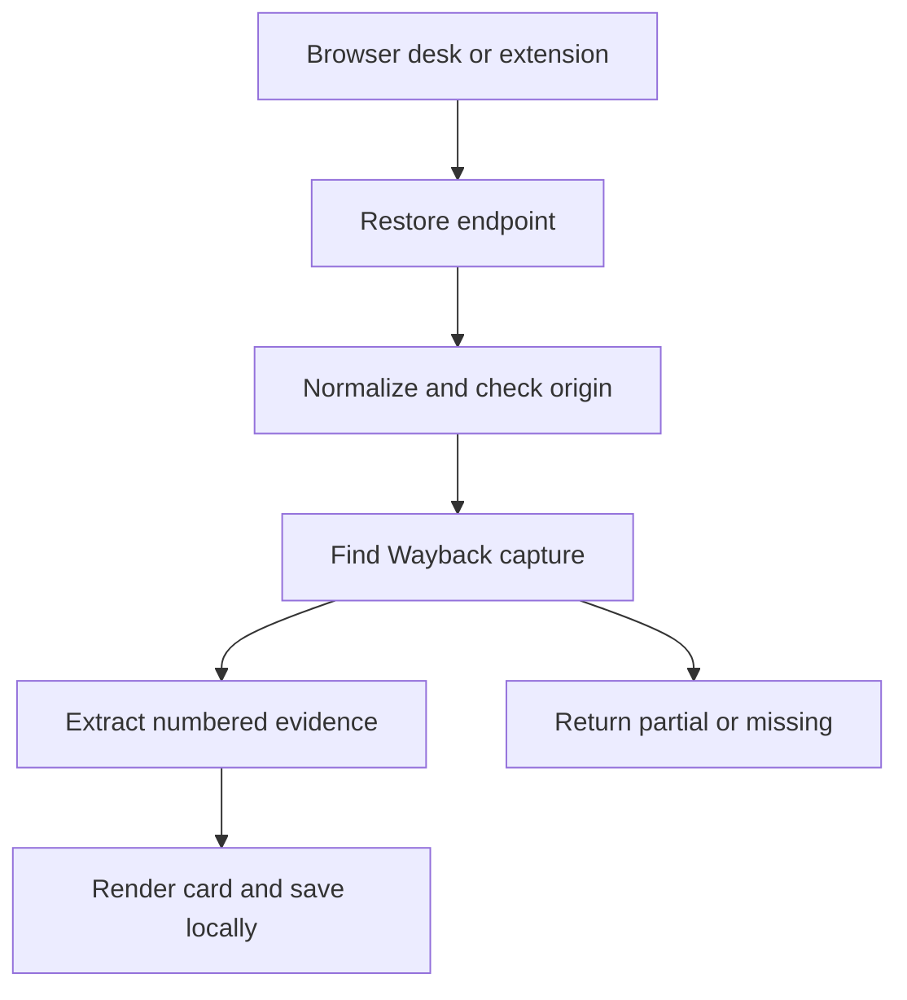

# Design

The archive provider is fixed. Origin connections use the resolved public address while preserving the hostname for HTTP and TLS. Only HTTP(S) and standard ports are supported. Replay body size is bounded and its content is converted to text. User-selected cards stay in browser storage. Source and date metadata remain visible on exports.
